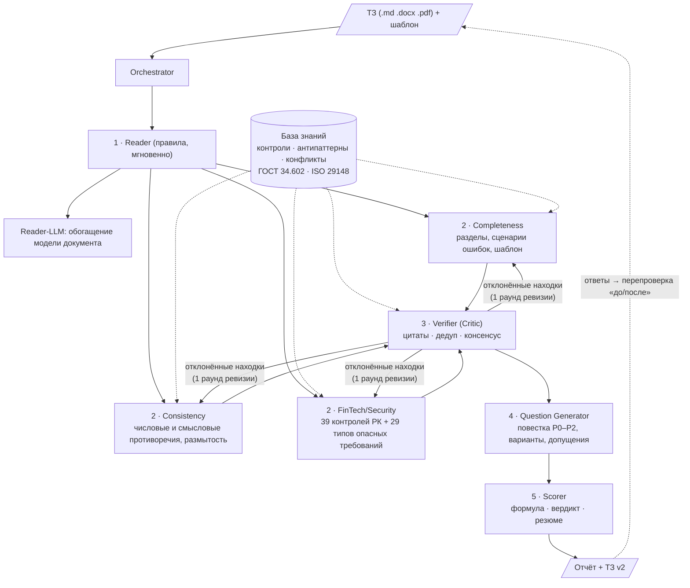

# 🛡️ Saqta TZ Auditor


**Мульти-агентная система проверки качества технических заданий финтех-проектов.**
BCC-HUB × MNU FinTech Hackathon · команда Saqta Labs

## ⚡ Прогон по заданию хакатона (агент проверки требований)

Агент проводит **статическую проверку документа требований** по ISO/IEC/IEEE 29148:2018 (п. 5.2.5 — каждое
требование, п. 5.2.6 — набор) и IEEE Std 830-1998 (п. 4.3) и записывает отчёт в файл.

**1. Установка** (Python 3.11+):

```bash
git clone https://github.com/Dossm04/saqta-tz-auditor.git && cd saqta-tz-auditor
pip install -r requirements.txt
```

**2. Ключ LLM.** Бесплатный ключ Google Gemini: <https://aistudio.google.com/apikey> → «Create API key».
Скопируйте `.env.example` в `.env` и вставьте ключ:

```bash
cp .env.example .env        # Windows: copy .env.example .env
# в .env: GEMINI_API_KEY=ваш_ключ   (модель: GEMINI_MODEL=gemini-3.5-flash)
```

Подходит и любой OpenAI-совместимый провайдер (`LLM_BASE_URL`, `LLM_API_KEY`, `LLM_MODEL` — см. `.env.example`).
Без ключа агент работает на детерминированных правилах и всё равно формирует отчёт (полнота ниже).

**3. Прогон одной командой:** путь к документу требований и путь к файлу отчёта.

```bash
python validate.py docs/requirements.pdf reports/report.md
```

Вход — `.pdf` (основной формат), `.docx`, `.md`, `.txt`. Отчёт на русском ляжет в указанный файл
(`reports/report.md`); `--json reports/report.json` дополнительно сохранит машиночитаемую версию,
`--offline` — прогон без LLM, `--model <имя>` — другая модель.

**Состав отчёта** (п. 6 задания): паспорт прогона (документ, дата, модель, версия агента — коммит) · таблица нарезки
требований «ID в отчёте — ID в документе — краткая формулировка/цитата» · проверка каждого требования по 10
характеристикам (+ риски ИБ) с цитатами и исправлениями · проверка набора (непротиворечивость, полнота, пропуски,
заполненный чек-лист ревью из документа) · сводка с критичными дефектами (непроверяемые, противоречивые, неполные) ·
итог «можно ли начинать разработку и тестирование» и что исправить в первую очередь · уточняющие вопросы автору.
Каждое нарушение ссылается на ID требования, строку и страницу и подтверждено дословной цитатой: претензии модели
без цитаты, найденной в документе, отбрасываются автоматически.

**Как устроен прогон:** Segmenter (нарезка) → Rule Checker (правила по каждой характеристике) → Requirement Critic
(LLM, пакеты требований) ‖ Set Critic (LLM, набор и чек-лист) ‖ Contradiction Hunter (LLM, попарные противоречия) ‖
**Domain Critic** (правила + LLM: часовой пояс и момент операции, единицы сумм, идемпотентность, возвраты, условия
измерения НФТ, сроки хранения данных, покрытие правил критериями приёмки) → Grounding Verifier (проверка цитат) → итог.
Пример отчёта по документу кейса — [reports/](reports/).

**Качество на документе кейса** (24 дефекта, размеченных вручную, [eval/iso/case_requirements.json](eval/iso/case_requirements.json)):

| Режим | Найдено |
|---|---|
| LLM + правила (gemini-3.5-flash) | **23 / 24 (96%)** |
| Только правила (`--offline`) | **22 / 24 (92%)** |

Честно о цифрах: доменные правила написаны после разбора пропусков на этом документе, поэтому офлайн-результат на нём
оптимистичен. Чтобы правила не шумели, они проверены на 12 других ТЗ из `samples/` (на эталонном `good_tz.md` —
ноль доменных замечаний) и закреплены тестами `tests/test_iso_domain.py`. Независимая оценка на документах, которые
система не видела, — слепая выборка ниже (50% правила, 67% с LLM).

```bash
python scripts/eval_iso.py            # офлайн
python scripts/eval_iso.py --llm      # LLM + правила (нужен ключ)
```

Если провайдер отвечает медленно, увеличьте `LLM_TIMEOUT` (секунды на один запрос) в `.env`.

---

> Загружаете ТЗ → 7 агентов находят пробелы, противоречия, размытые формулировки, **опасные требования**
> и нарушения требований регулятора РК → вы получаете оценку готовности, **повестку встречи** с уточняющими
> вопросами (варианты ответа, адресат, допущение по умолчанию) и черновик исправленного **ТЗ v2**.

Инструмент для бизнес-аналитиков и продакт-менеджеров: ревью ТЗ, которое занимает у аналитика и
ИБ-специалиста ≈ 4 часа, система делает за секунды (офлайн) или минуты (LLM) и не забывает про комплаенс.

---

## Что делает

| На входе | На выходе |
|---|---|
| ТЗ в `.md`, `.txt`, `.docx`, `.pdf` | Оценка 0–100 по 5 измерениям и вердикт готовности, «⏱ N с вместо ≈ M ч ручного ревью» |
| Шаблон ТЗ организаторов / банка (опц.) | Находки с **дословными цитатами и номерами строк**, нормой, рекомендацией и готовой формулировкой |
| | **Повестка встречи**: вопросы P0/P1/P2 по адресатам (ИБ, Комплаенс, Бизнес…), с цитатой, «зачем», «если не ответить», 2–3 вариантами ответа под практику РК, рекомендуемым вариантом и допущением по умолчанию |
| | Матрица соответствия 39 финтех/ИБ-контролям РК и проверка по шаблону ТЗ |
| | **ТЗ v2**: опасные строки заменены, недостающие требования и ответы дописаны → перепроверка **«до / после»** |
| | Экспорт: **Word**, Markdown, JSON, повестка встречи |

Демо-ТЗ мобильного банка (офлайн-правила): **47/100 «Не готово»** (10 критичных) → после «принять рекомендуемые ответы»
(20 ответов на вопросы P0/P1) и ТЗ v2 → **76/100 «Требует доработки»**, критичных 10 → 0; остаются 15 важных и 10 мелких
замечаний, которые дорабатывает автор. Эталонное ТЗ — **100/100 «Готово к разработке»**.

## Качество измерено, а не заявлено

`scripts/eval.py` прогоняет систему по ТЗ с размеченными дефектами (golden labels: строка, тип дефекта) и строками,
которые **нельзя** флагать; считает полноту и ложные срабатывания.

| Набор | ТЗ | Офлайн-правила: найдено | Ложные |
|---|---|---|---|
| Dev (на нём настраивались правила) | 7 ТЗ: мобильный банк, кредитование/BNPL, эквайринг, кошелёк, депозиты, международные переводы, маркетплейс | **116 / 116 (100%)** | **0** |
| **Слепая отложенная выборка v2** (написана агентами без доступа к правилам, заморожена) | кредитные карты, Open Banking API, зарплатный проект | **24 / 48 (50%)** | **0** |
| **Слепая выборка v2, LLM-агенты + правила** (Gemini free tier) | те же | **32 / 48 (67%)** | 2 |

Честная интерпретация: правила **точны** (0 ложных срабатываний на незнакомых ТЗ) и мгновенны, но словарями не покрыть всё
разнообразие формулировок — на незнакомых ТЗ они ловят около половины дефектов (полностью — пропущенные разделы и контроли,
частично — новые виды опасных требований). **LLM-слой добавляет +17 п.п.** (противоречия, опасные требования), а правила
его заземляют и страхуют. Замер LLM сделан на перегруженном бесплатном Gemini (часть агентов откатилась на правила) —
это нижняя оценка. Подробности — [docs/EVAL.md](docs/EVAL.md).
Первая слепая выборка (v1) после использования для доработки перенесена в dev-набор — поэтому v2 сделана заново.

```bash
python scripts/eval.py              # dev-набор
python scripts/eval.py --holdout    # слепая выборка
python scripts/eval.py --holdout --llm   # с LLM-агентами (нужен ключ)
```

## Архитектура



Стадии последовательны, агенты внутри стадии — **параллельны** (`asyncio`). Агенты обмениваются типизированными
объектами (pydantic) через общий контекст и **явными сообщениями** (кто → кому → что); в UI граф строится по реальному запуску.

| Агент | Роль | Ключевая идея |
|---|---|---|
| **Reader** | Модель документа: домены, роли, требования, интеграции, данные | Правила мгновенно, LLM обогащает параллельно со стадией 2; «не входит в MVP» исключается из доменов |
| **Completeness** | Пропущенные разделы (ГОСТ 34.602, ISO 29148) и негативные сценарии по доменам; проверка по шаблону | Шаблон организаторов → обязательные разделы и незаполненные поля |
| **Consistency** | Противоречия (числовые — по сущности, смысловые — по полярности «запрещено/разрешено»), размытые формулировки, TBD | Учитывает периоды, уровни идентификации, продукты, диапазоны — не путает разные лимиты |
| **FinTech/Security** ⭐ | Матрица контролей + поиск **опасных требований** | Не только «чего нет», но и «что написано и опасно»: CVV, PAN в логах, fail-open проверки, вебхуки без подписи… |
| **Verifier (Critic)** | Контроль качества других агентов | Цитата ищется в тексте; неподтверждённое отсекается; «отсутствие» перепроверяется; дубли склеиваются; в LLM-режиме отклонённые находки уходят агенту на ревизию |
| **Question Generator** ⭐ | Повестка встречи | Гарантированное покрытие критичных, противоречий, опасных требований и TBD; линтер качества вопросов + починка LLM; варианты из базы знаний |
| **Scorer** | Оценка и вердикт | Детерминированная формула — балл нельзя «уговорить» текстом внутри ТЗ |

### Надёжность

- **Гибрид LLM + правила.** Каждый агент умеет работать на правилах; правила дают LLM подсказки и проверяют его ответы.
- **Устойчивость к провайдеру:** ротация резервных моделей при 429/503/404, экспоненциальная пауза, бюджет ожидания на вызов,
  затем откат на правила (`fallback`, жёлтая карточка в UI) — отчёт строится всегда.
- **Кэш ответов LLM** (`.cache/llm`, ключ включает провайдера и модель): повторный анализ мгновенный и воспроизводимый — для живого демо.
- **ТЗ — это данные:** текст ТЗ обёрнут в `<tz>…</tz>`, инструкции внутри документа не выполняются (защита от prompt injection).
- **Нормы — только из белого списка:** LLM не выдумывает номера статей и постановлений.

### Приватность для банка

- Пресет **«Локальная модель (Ollama, контур банка)»** — данные не покидают периметр.
- Для облачных моделей — **маскирование** ИИН, БИН, номеров карт (Luhn), телефонов, e-mail, IBAN, названий организаций
  перед отправкой и обратная подстановка в ответе (`privacy.py`, `LLM_PRIVACY=auto|on|off`). Подробнее — `docs/PRIVACY.md`.

## База знаний (экспертиза ИБ и регуляторики РК как данные)

- `knowledge/fintech_controls.py` — **39 контролей** с применимостью по доменам, признаками покрытия, нормой, вопросом,
  2–3 вариантами ответа и допущением по умолчанию: аутентификация и SCA, сессии, шифрование и ключи, PCI DSS v4.0.1, 3-D Secure;
  ПДн (Закон РК №94-V: согласие, **хранение в РК**, сроки), **банковская тайна**; ПОД/ФТ (Закон №191-IV: KYC, ЦОИД/биометрия, АФМ,
  санкции и ПДЛ); платежи (Закон №11-VI, **Антифрод-центр НБРК**); требования к ИБ банков (**Пост. АРРФР №53 от 03.04.2026**,
  ДБО, доступ третьих лиц, инциденты); кредитование (ГЭСВ, кредитное бюро, КДН, **период охлаждения** по Закону №205-VIII,
  самозапрет, автоматизированные решения); ЭЦП по Цифровому кодексу; идемпотентность, лимиты, антифрод, сверка, округление; AppSec.
- `knowledge/antipatterns.py` — **29 типов опасных требований**: хранение CVV, PAN/ПДн в логах, пароли в открытом виде, MD5,
  операции без подтверждения, ПДн за рубежом, fail-open проверки, пропуск санкционного скрининга, доверие клиентским расчётам,
  смена реквизитов выплат без проверки, вебхуки без подписи, секреты по e-mail, слабое подтверждение операций и др.
- `knowledge/language.py` — размытые формулировки, TBD, метрики и **семейства смысловых конфликтов**.
- `knowledge/tz_structure.py` — 16 обязательных разделов ТЗ; `knowledge/template.py` — проверка по произвольному шаблону.

> Ссылки на нормы сверены с первоисточниками (adilet.zan.kz, АРРФР, НБРК) на ноябрь 2026 и даны для ориентира;
> перед официальным заключением сверяйте актуальную редакцию.

## Оценка

| Измерение | Вес | Категории находок |
|---|---|---|
| Безопасность и комплаенс | 40% | security, compliance, fintech (+50% — покрытие контролей) |
| Полнота | 20% | completeness |
| Однозначность | 15% | ambiguity |
| Тестируемость | 15% | testability |
| Непротиворечивость | 10% | contradiction |

`score = 100 · exp(−Σ penalty / 70)`, штраф: critical 18, major 8, minor 3 (× max(0.5, уверенность)).
Вердикт: **≥ 80 и нет критичных** — «Готово к разработке»; **≥ 55 и ≤ 2 критичных** — «Требует доработки»; иначе — «Не готово».

## Запуск

```bash
pip install -r requirements.txt
cp .env.example .env          # LLM_API_KEY необязателен — без него офлайн-режим
streamlit run app.py          # веб-интерфейс
python cli.py samples/sample_tz.md --docx report.docx --json report.json   # CLI
python cli.py my_tz.docx --template organizers_template.docx              # проверка по шаблону
python -m pytest -q tests     # 400+ тестов, включая LLM-путь на фейковой модели и UI
docker build -t tz-auditor . && docker run -p 8501:8501 -e LLM_API_KEY=... tz-auditor
```

Провайдер LLM — любой OpenAI-совместимый (`LLM_BASE_URL`, `LLM_API_KEY`, `LLM_MODEL`, `LLM_FALLBACK_MODELS`):
Google Gemini, OpenAI, shai.pro, Claude через OpenAI-совместимый эндпоинт, локальные модели (Ollama/vLLM). Пресеты — в боковой панели UI.

## Структура

```
app.py              Streamlit UI: живой граф агентов, повестка встречи, до/после, матрица, документ с разметкой, экспорт
cli.py              командная строка (Markdown / JSON / Word, --template)
models.py           pydantic-схемы: Finding, Question, ControlCheck, Report, сообщения агентов, метрики качества вопросов
parsing.py          .md/.txt/.docx/.pdf → нумерованные строки; нечёткий поиск цитат
improve.py          ТЗ v2 (замена опасных строк с сохранением нумерации и таблиц, дописывание требований и ответов)
privacy.py          маскирование ПДн перед облачным LLM
report.py · report_docx.py   экспорт Markdown / JSON / Word
agents/             base (LLM-клиент: JSON, ротация моделей, кэш), orchestrator, reader, analyzers, verifier, questions, scorer, rules
knowledge/          контроли РК, опасные требования, язык и конфликты, разделы ТЗ, шаблоны, домены
prompts/            промпты агентов (редактируются без изменения кода)
samples/ · eval/    размеченные ТЗ: dev-набор и слепая выборка
scripts/eval.py     метрики качества
docs/               PITCH.md (сценарий питча и ответы жюри), PRIVACY.md, EVAL.md
tests/              unit-, интеграционные и UI-тесты
```

## Демо за 3 минуты

1. «Мобильный банк (с дефектами)» → **Анализировать**: агенты загораются по стадиям, три аналитика параллельно.
2. **47/100 «Не готово»**, ⏱ ≈ 1 с вместо ≈ 4 ч. Находка «хранение CVV» — цитата L35, PCI DSS, готовая формулировка.
   Противоречие L43 «без подтверждения» ↔ L44 «каждая операция подтверждается».
3. **Повестка встречи**: вопросы по адресатам, «≈ N минут», варианты ответа ★ — **«Принять рекомендуемые»**.
4. **«Сформировать ТЗ v2 и перепроверить»** → панель **До / После**.
5. «Агенты и архитектура»: граф реального запуска, журнал сообщений, статистика Verifier. **Экспорт в Word**.

Подробный сценарий и ответы на вопросы жюри — [docs/PITCH.md](docs/PITCH.md).
