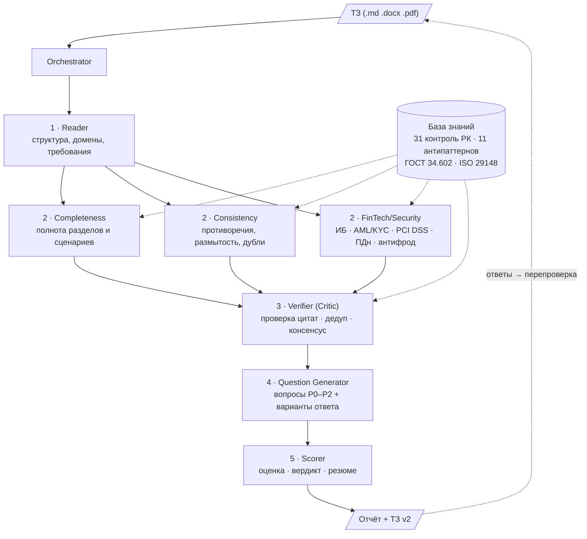

# 🛡️ Saqta TZ Auditor

**Мульти-агентная система проверки качества технических заданий финтех-проектов.**
BCC-HUB × MNU FinTech Hackathon · команда Saqta Labs

> Загружаете ТЗ → 7 агентов за секунды находят пробелы, противоречия, размытые формулировки,
> **опасные требования** и нарушения требований регулятора РК → вы получаете оценку готовности,
> приоритизированные уточняющие вопросы с вариантами ответа и черновик исправленного ТЗ v2.

Инструмент для бизнес-аналитиков и продакт-менеджеров: то, что на ревью ТЗ занимает у
аналитика и ИБ-специалиста 1–2 дня, система делает за минуту и не забывает про комплаенс.

---

## Что делает

| На входе | На выходе |
|---|---|
| ТЗ в `.md`, `.txt`, `.docx`, `.pdf` | Оценка 0–100 по 5 измерениям и вердикт готовности |
| | Находки с **дословными цитатами и номерами строк**, нормой, рекомендацией и готовой формулировкой |
| | **Уточняющие вопросы** P0/P1/P2 с адресатом (бизнес / ИБ / комплаенс…) и вариантами ответа |
| | Матрица соответствия 31 финтех/ИБ-контролю РК |
| | **ТЗ v2**: опасные строки заменены, недостающие требования дописаны → перепроверка «до/после» |

Пример на демо-ТЗ мобильного банка: **49/100 «Не готово»** → после генерации ТЗ v2 → **73/100**,
критичных замечаний 9 → 0. Полностью проработанное ТЗ получает **99/100 «Готово к разработке»**.

## Архитектура



Стадии выполняются последовательно, три аналитика стадии 2 — **параллельно** (`asyncio.gather`).
Агенты общаются через типизированный контекст (pydantic-схемы), а не через свободный текст.

| Агент | Роль | Ключевая идея |
|---|---|---|
| **Reader** | Нормализует ТЗ: домены (переводы, карты, KYC…), роли, требования, интеграции, категории данных | Домены определяют, какие контроли применимы; «не входит в MVP» исключается |
| **Completeness** | Пропущенные разделы (ГОСТ 34.602-2020, ISO 29148) и сценарии (ошибки, граничные случаи) | Пред-проверка правилами + LLM ищет конкретные пропущенные сценарии |
| **Consistency** | Противоречия (в т.ч. численные: лимиты, SLA), размытые формулировки, дубли | Детектор числовых конфликтов с учётом контекста (суточный ≠ на операцию) |
| **FinTech/Security** ⭐ | Матрица 31 контроля + поиск **опасных требований** | Ищет не только «чего нет», но и «что написано и опасно»: хранение CVV, PAN в логах, MD5, операции без подтверждения |
| **Verifier (Critic)** | Контроль качества других агентов | Каждая цитата ищется в тексте; находки без подтверждения отбрасываются; «отсутствие» перепроверяется; дубли склеиваются, согласие агентов повышает уверенность |
| **Question Generator** ⭐ | Вопросы к автору ТЗ | Привязаны к строке ТЗ, закрывающие (2–3 варианта ответа), с адресатом и приоритетом; каждая критичная находка покрыта вопросом |
| **Scorer** | Оценка и вердикт | Детерминированная прозрачная формула; LLM пишет только текст резюме |

### Гибрид «LLM + правила»: почему это надёжно

Каждый агент работает в двух режимах:

- **LLM** — узкий промпт (`prompts/*.md`) + ответ строго по JSON-схеме, валидация pydantic,
  повтор с обратной связью валидатора при ошибке;
- **Rules** — детерминированные проверки по базе знаний (`knowledge/`).

Правила дают LLM-агентам **подсказки** (pre-check), а Verifier использует их, чтобы **проверять
заявления LLM**. Без API-ключа вся система работает офлайн.

Устойчивость к провайдеру (проверено на перегруженном бесплатном Gemini):

1. **Ротация моделей** — при 429/503/тайм-ауте запрос уходит на следующую модель из
   `LLM_FALLBACK_MODELS`, после полного круга — экспоненциальная пауза; несуществующие (404) модели исключаются.
2. **Бюджет ожидания** (`LLM_CALL_BUDGET`, 150 с) — если провайдер так и не ответил, агент
   откатывается на правила (`fallback`, жёлтая карточка в UI), отчёт всё равно строится.
3. **Кэш ответов** (`.cache/llm`) — повторный анализ того же ТЗ мгновенный и воспроизводимый.
4. **Семафор** (`LLM_MAX_CONCURRENCY`) — не превышаем лимиты бесплатных тарифов.

### Защита от галлюцинаций (Verifier)

1. Все строки ТЗ нумеруются (`L1…Ln`); агенты обязаны цитировать дословно.
2. Verifier ищет каждую цитату в документе (точное + нечёткое совпадение ≥ 0.75).
   Находка «о тексте» без подтверждённой цитаты **отбрасывается**.
3. Если LLM пишет «контроль покрыт», но цитату найти нельзя — статус откатывается.
4. Если агент утверждает «темы нет», а правила находят её упоминания — серьёзность понижается с пометкой.
5. Дубли между агентами склеиваются; подтверждение несколькими агентами повышает уверенность.

Статистика Verifier показывается в отчёте: сколько находок пришло, склеено, отсечено, понижено.

## База знаний (экспертиза ИБ как данные)

`knowledge/fintech_controls.py` — 31 контроль с применимостью по доменам, признаками покрытия,
нормой, вопросом, вариантами ответа и готовой формулировкой требования:

- **Аутентификация:** MFA, подтверждение операций (SCA с привязкой к сумме/получателю), сессии и перебор, хранение ПИН/паролей
- **Защита данных:** TLS 1.2+ и pinning, шифрование at rest и ключи (HSM/KMS), PCI DSS, 3-D Secure
- **ПДн (Закон РК №94-V):** согласие, хранение баз на территории РК, сроки хранения и удаление
- **ПОД/ФТ (Закон РК №191-IV):** KYC и дистанционная идентификация, финмониторинг и АФМ, санкционные перечни и ПДЛ, уровни идентификации
- **Платежи (Закон РК №11-VI):** сроки исполнения, отзыв и оспаривание, раскрытие комиссий
- **Логика денег:** идемпотентность, лимиты, антифрод и социальная инженерия, статусы и сверка, округление
- **AppSec:** SAST/DAST и пентест, защита мобильного приложения (MASVS), безопасность API
- **Кредитование:** ГЭСВ, кредитное бюро, КДН · **Биометрия:** liveness, шаблоны, согласие · **Язык:** казахский и русский

`knowledge/antipatterns.py` — 11 опасных требований (хранение CVV, PAN/ПДн в логах, пароли в
открытом виде, MD5/SHA-1, отключение TLS, операции без подтверждения/лимитов, передача ПДн без
согласия, секреты в коде, карта на устройстве, хранение фото лица).

> Ссылки на нормы — ориентир для аналитика; перед официальным заключением сверяйте актуальную редакцию (НБРК / АРРФР / АФМ).

## Оценка

Пять измерений, итог — взвешенная сумма:

| Измерение | Вес | Категории находок |
|---|---|---|
| Безопасность и комплаенс | 40% | security, compliance, fintech (+50% — покрытие контролей) |
| Полнота | 20% | completeness |
| Однозначность | 15% | ambiguity |
| Тестируемость | 15% | testability |
| Непротиворечивость | 10% | contradiction |

`score = 100 · exp(−Σ penalty / 70)`, штраф: critical 18, major 8, minor 3 (× уверенность).
Вердикт: **≥ 80 и нет критичных** — «Готово к разработке»; **≥ 55 и ≤ 2 критичных** — «Требует доработки»; иначе — «Не готово».

## Запуск

```bash
pip install -r requirements.txt
cp .env.example .env          # укажите LLM_API_KEY (необязательно — без него офлайн-режим)
streamlit run app.py          # веб-интерфейс
python cli.py samples/sample_tz.md --out report.md --json report.json   # CLI
python cli.py samples/sample_tz.md --offline                             # без LLM
python -m pytest -q tests     # тесты (включая LLM-путь на фейковой модели)
```

Провайдер LLM — любой OpenAI-совместимый (`LLM_BASE_URL`, `LLM_API_KEY`, `LLM_MODEL`):
OpenAI, shai.pro, Claude через OpenAI-совместимый эндпоинт, локальные модели. Если провайдер
не поддерживает `response_format`, клиент сам отключит JSON-режим.

## Структура

```
app.py              Streamlit UI: живой граф агентов, вопросы, находки, матрица, документ с разметкой, ТЗ v2
cli.py              командная строка
models.py           pydantic-схемы: Finding, Question, ControlCheck, Report…
parsing.py          .md/.txt/.docx/.pdf → нумерованные строки; поиск цитат
improve.py          генерация ТЗ v2 (замена опасных строк, дописывание требований, ответы)
report.py           экспорт Markdown / JSON
agents/
  base.py           LLM-клиент (JSON + ретраи), контекст, базовый агент с fallback
  orchestrator.py   граф стадий, параллельный запуск, сборка отчёта
  reader.py · analyzers.py · verifier.py · questions.py · scorer.py
  rules.py          детерминированные проверки по базе знаний
knowledge/          контроли РК, антипаттерны, разделы ТЗ, словарь размытых формулировок
prompts/            промпты агентов (редактируются без изменения кода)
samples/            демо-ТЗ с дефектами и исправленная версия
tests/              тесты конвейера, верификатора, .docx и цикла ТЗ v2
```

## Сценарий демо (3 минуты)

1. Демо-ТЗ мобильного банка → «Анализировать»: агенты загораются по стадиям, три аналитика работают параллельно.
2. Итог **49/100 «Не готово»**: 9 критичных. Показать находку «хранение CVV» — цитата, строка L35, PCI DSS 3.3, готовая формулировка.
3. Вкладка «Вопросы»: P0-блокеры с вариантами ответа и адресатом — «вот повестка встречи с заказчиком».
4. «Матрица контролей»: покрытие требований регулятора РК (ПДн на территории РК, АФМ, ПОД/ФТ).
5. Выбрать ответы → «Сформировать ТЗ v2 и перепроверить» → **73/100, ▲24**, критичных 0.
6. «Агенты и архитектура»: граф, трассировка, статистика Verifier (сколько галлюцинаций отсечено).
